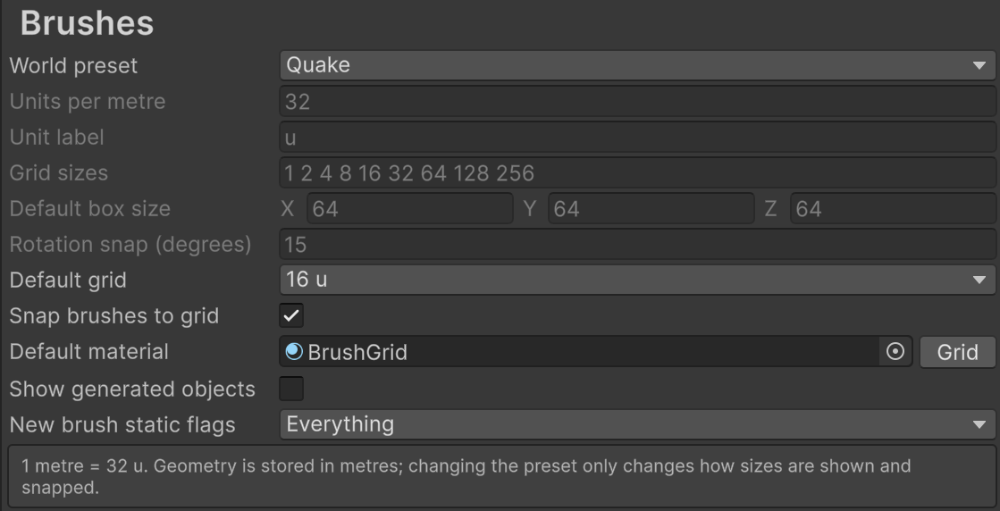
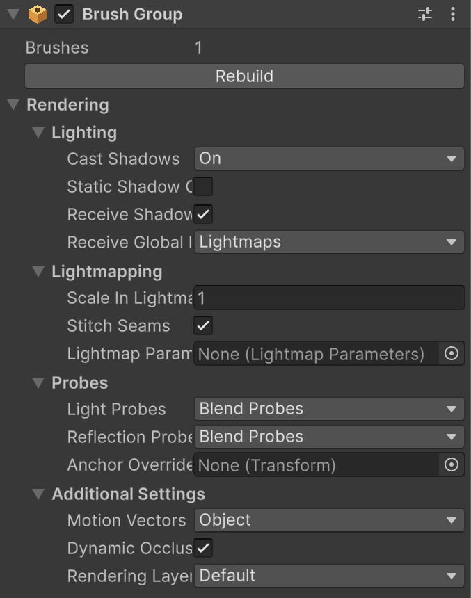

# Brush Group rendering and lightmapping

CSG Brush builds the brushes under a **Brush Group** into render meshes and colliders. Brushes that aren't under a Brush Group are built by the scene's automatic group. This page explains how static flags, renderer settings, and lightmap UVs apply to that output.

## Static flags

Each brush's static flags control its own geometry. Set them with the **Static** checkbox or dropdown at the top of the Inspector, as for any GameObject.

* The brush's colliders take its static flags.
* The brush's faces render in a mesh with the same static flags. Static brushes batch, occlude, and receive lightmaps. Brushes that aren't static render in a separate mesh, so you can move or animate them.
* Static and non-static brushes still carve each other. The faces that a cut creates, such as the sides of a doorway, take the static flags of the brush they're cut into.

New brushes and Floor Plans start with the static flags set in **Project Settings** > **Brushes** > **New brush static flags**.

> [!NOTE]
> The static flags of the Brush Group GameObject itself don't affect its meshes.

## Moving groups

A Brush Group's transform moves everything the group builds: its meshes and its colliders. To build something once and move it as a whole at runtime, such as a lift or a drawbridge, put its brushes under their own Brush Group and turn on **Moving** in the group's Inspector. The group's brushes then aren't static, so their meshes can move. Move or animate the group's transform, not the brushes: CSG Brush builds in the editor only, so a brush moved at runtime isn't carved again.

## Renderer settings

The **Rendering** section of the Brush Group Inspector holds the settings of a Mesh Renderer. Every render mesh of the group uses them. The materials come from the brushes.

To change the renderer settings of a group:

1. Select the GameObject with the **Brush Group** component.
2. In the Inspector, expand **Rendering**.
3. Change the settings. The group's meshes update immediately.

The defaults match a new Mesh Renderer, so a group you don't change, and the scene's automatic group, render with Unity's defaults.

## Lightmap UVs

Static brushes that contribute to global illumination need lightmap UVs. CSG Brush makes them the way ProBuilder does: not while you edit, because unwrapping large meshes is slow, but once an edit is finished.

* With **Auto lightmap UVs** enabled in **Project Settings** > **Brushes** (the default), lightmap UVs are made shortly after you stop editing a group.
* With it disabled, click **Generate Lightmap UVs** in the Brush Group's **Lightmapping** section, or choose **Tools** > **CSG Brush** > **Generate Lightmap UVs**, before you bake.

Any edit to a group's brushes builds its meshes again without lightmap UVs, and they're made again once the edit is finished. The baked lighting is then out of date until you bake again.

The meshes are saved in the scene with their lightmap UVs. When the scene opens again, a group whose brushes haven't changed keeps its meshes exactly as they were, so the baked lighting stays valid. **Rebuild** builds them again from the brushes.

After a bake, the Console lists any lit brush mesh that had no lightmap UVs: Unity leaves such meshes out of the bake.

To control lightmap texel density, set **Scale In Lightmap** in the group's **Rendering** section. Use separate Brush Groups for areas that need different densities.

## Save to Blender

To edit or render a Brush Group's geometry in Blender, click **Save to Blender…** in the group's Inspector. CSG Brush uses the Blender installed on your computer to write a `.blend` file, so you need Blender 3.6 or newer, free from [blender.org](https://www.blender.org/download/).

1. Select the GameObject with the **Brush Group** component.
2. Click **Save to Blender…**, choose where to save the file, and click **Save**.

The group remembers the file. The next time you click **Save to Blender…**, you can overwrite it or save as a new file.

The file holds the group's meshes as they render in Unity:

* **Place and size:** in metres, with the group's position as the origin. Blender's Z axis is Unity's Y axis, so the level stands upright.
* **Surfaces:** the same faces and normals.
* **UVs:** a `UVMap` UV map for textures, and a `Lightmap` UV map when the meshes have lightmap UVs.
* **Materials:** one per Unity material, with its name, color, and main texture.

If CSG Brush can't find Blender, it offers to download it or to locate it. To use a particular Blender, set **Blender** in **Project Settings** > **Brushes**. When it's empty, CSG Brush looks where Blender is usually installed.

## Brush Group component reference

| **Property** | **Description** |
| :--- | :--- |
| **Brushes** | The number of brushes the group builds. |
| **Rebuild** | Builds the group's meshes and colliders again from scratch. For a group in a prefab, this rebuilds the prefab. |
| **Save to Blender…** | Saves the group's meshes as a Blender file. See [Save to Blender](#save-to-blender). |

### Rendering

#### Lighting

| **Property** | **Description** |
| :--- | :--- |
| **Cast Shadows** | Whether and how the meshes cast shadows: **Off**, **On**, **Two Sided**, or **Shadows Only**. |
| **Static Shadow Caster** | Casts shadows into cached shadow maps only once, for static lights. |
| **Receive Shadows** | Receives shadows from other objects. |
| **Receive Global Illumination** | Whether static meshes that contribute to global illumination receive it from **Lightmaps** or **Light Probes**. |

#### Lightmapping

| **Property** | **Description** |
| :--- | :--- |
| **Scale In Lightmap** | The lightmap texel density relative to the rest of the scene. **2** is twice as sharp, **0.5** is half. |
| **Stitch Seams** | Blends lightmap seams where faces meet. |
| **Lightmap Parameters** | A Lightmap Parameters asset. When empty, the meshes use the scene's default. |
| **Hard Angle** | Edges sharper than this angle, in degrees, split the lightmap UVs. |
| **Angle Error** | How much the lightmap UVs may distort angles, in percent. |
| **Area Error** | How much the lightmap UVs may distort areas, in percent. |
| **Pack Margin** | Pixels between UV islands, for a mesh that fills a 1024-pixel lightmap. Increase it if lighting bleeds between faces. |
| **Generate Lightmap UVs** | Makes the lightmap UVs of the group's lit meshes now. Visible when they're missing. |

#### Probes

| **Property** | **Description** |
| :--- | :--- |
| **Light Probes** | How meshes that aren't lightmapped use light probes. |
| **Reflection Probes** | How the meshes use reflection probes. |
| **Anchor Override** | The point where probes are sampled. When empty, each mesh uses the centre of its bounds. |

#### Additional Settings

| **Property** | **Description** |
| :--- | :--- |
| **Motion Vectors** | The motion vectors mode, for motion blur and temporal effects. |
| **Dynamic Occlusion** | Hides the meshes when they're occluded, even if they aren't static. |
| **Rendering Layer Mask** | The rendering layers the meshes are on, for light layers and decal layers. |

## Additional resources

* [Lightmapping](https://docs.unity3d.com/Manual/Lightmappers.html) in the Unity Manual
* [Mesh Renderer component](https://docs.unity3d.com/Manual/class-MeshRenderer.html) in the Unity Manual
